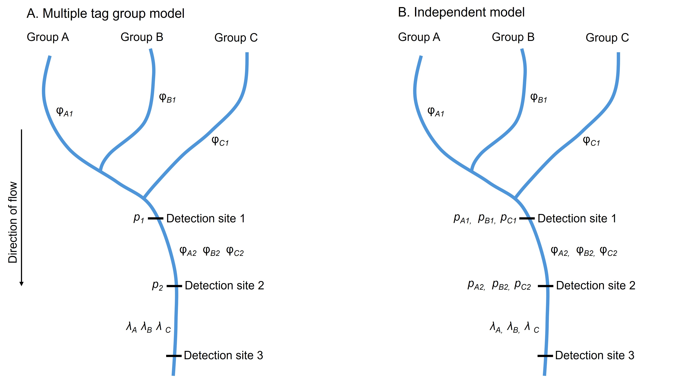

```{r setup, include=FALSE}
knitr::opts_chunk$set(echo = FALSE, results = FALSE, warning = FALSE)
```

```{r, include = FALSE}

#remotes::install_github("ryankinzer/PITmodelR", ref = "dev", build_vignettes = F, force = T)

library(PITmodelR)
library(tidyverse)
library(RTMB)
library(ggh4x)
library(viridis)
library(ggpubr)
library(knitr)
library(kableExtra)

plot_theme <- readRDS("templates/plot_theme_v2.RDS")
```

```{r define-scenarios}

#number of occasions
n_occ <- 4

#number of fish tagged
n_init <- matrix(c(150, 300, 600), byrow = TRUE, ncol = 1)

#number of additional tags added per occasion
n_add <- c(0, 0, 0, 0)

#survival
phi_sim_mat <- matrix(c(0.6, 0.6, 0.6), 
                 byrow = TRUE, ncol = 3)

#detection
p_sim_mat <- matrix(c(1, 0.5, 0.5, 0.5, 
                      1, 0.25, 0.25, 0.5,
                      1, 0.05, 0.5, 0.5, 
                      1, 0.05, 0.25, 0.5), 
                    byrow = TRUE, ncol = 4)

#proportion of fish removed by occasion
#Removal probability appears to be ~2%, so set a constant removal probability
removals <- c(0, 0.02, 0.02, 0.02)

#number of release_groups
n_rel_groups <- 3

#matrix, rows = release groups, cols = occasions
sites <- matrix(c("relA", "det1", "det2", "det3", 
                  "relB", "det1", "det2", "det3", 
                  "relC", "det1", "det2", "det3"), nrow = n_occ, ncol = n_rel_groups)

#number of iterations per scenario
n_iter <- 500

scenario_grid <- expand_grid(
  n_init_sim = 1:nrow(n_init),
  s_sim = 1:nrow(phi_sim_mat),
  p_sim = 1:nrow(p_sim_mat)
  #r_sim = 1:nrow(removals)
) %>%
  mutate(N = map(n_init_sim, ~n_init[.x, ]),
    S = map(s_sim, ~ phi_sim_mat[.x, ]),
    p = map(p_sim, ~ p_sim_mat[.x, ])
    #remove = map(r_sim, ~ removals[.x, ])
    )

n_scenarios <- dim(scenario_grid)[1]
```

```{r run-sims, eval=FALSE}
#Do not re-run the simulations


phi_mult_list <- vector("list", length = n_scenarios * n_iter)
p_mult_list <- vector("list", length = n_scenarios * n_iter)
phi_ind_list <- vector("list", length = n_scenarios * n_iter)
p_ind_list <- vector("list", length = n_scenarios * n_iter)
counter <- 1

for (t in 1:dim(scenario_grid)[1]) {
  for (i in 1:n_iter) { #500 iterations per scenario
    
    sim_list <- vector("list", length = n_rel_groups)
    
    for (g in 1:n_rel_groups) { #loop over release groups
      
      obs_loc <- as.list(sites[, g])
      names(obs_loc) <- sites[, g]

        #simulate dataset
        sim_events <- simulate_cjs_events(
          n_init = scenario_grid$N[[t]],
          n_add = n_add,
          sites = sites[, g],
          S = scenario_grid$S[[t]],
          p = scenario_grid$p[[t]],
          #remove_prob = scenario_grid$remove_prob[[t]]
          remove_prob = c(0, 0.02, 0.02, 0.02)
          )
        
        #format dataset
        sim_compile <- tibble(
          srr = "sim",
          release_site = sites[1, g],
          release_season = "test",
          data = list(sim_events),
          obs_loc = list(obs_loc))
        
        sim_list[[g]] <- sim_compile
        
    }
    
   sim_list_df <- bind_rows(sim_list)
   
   #create ch and m array  
   sim_long_list <- sim_list_df %>%
      mutate(
        ch = map2(
          data,
          obs_loc,
          ~ build_capture_histories(
            tag_history = .x,
            locs_def = .y,
            site_col = "obs_site",
            tag_col = "tag_code",
            time_col = "first_obs",
            censor_col = "last_censored",
            covariate_cols = NULL
          )
        )
      )
    
    #individual m array for each release group
    marray_list <- sim_long_list %>%
      mutate(m_array = map(
        ch, ~(marray = .x$m_array))) %>%
      select(srr, release_site, m_array) %>%
      rename(release_group = release_site)
      
    #fit the multiple release group m-array model
    #shared p for detection sites
    #all unique survival parameters
    fit_mult <- fit_marray_cjs_multiple(marray_list, shared_p = "All", shared_phi = "None")
    
    #fit the independent release group m-array model
    fit_ind <- marray_list %>%
      mutate(fit = map(m_array, ~fit_marray_cjs(.x)))
    
    #format fit_ind
    phi_ind_list_g <- vector("list", length = n_rel_groups)
    
    for (g in 1:n_rel_groups) {
      phi <- fit_ind$fit[[g]]$phi
      phi <- phi %>%
        mutate(release_group = sites[1, g], 
               from_site = sites[, g][seq(1, n_occ - 2)], 
               to_site = sites[, g][seq(2, n_occ - 1)], 
               scenario = t, 
               iter = i)
      
      phi_ind_list_g[[g]] <- phi
    }      
      
    phi_ind <- bind_rows(phi_ind_list_g)  
    
    p_ind_list_g <- vector("list", length = n_rel_groups)
    
    for (g in 1:n_rel_groups) {
      p <- fit_ind$fit[[g]]$p
      p <- p %>%
        mutate(release_group = sites[1, g], 
               site = sites[, g][seq(2, n_occ - 1)], 
               scenario = t, 
               iter = i)
      
      p_ind_list_g[[g]] <- p
    }      
    
    p_ind <- bind_rows(p_ind_list_g) 
    
    #format fit_mult
    phi_mult <- fit_mult$phi %>%
      mutate(scenario = t, 
                 iter = i)
        
    p_mult <- fit_mult$p %>%
      mutate(scenario = t, 
                 iter = i)
        
    #add estimates to list, separately by phi and p for grouped and independent
    phi_mult_list[[counter]] <- phi_mult
    p_mult_list[[counter]] <- p_mult
    phi_ind_list[[counter]] <- phi_ind
    p_ind_list[[counter]] <- p_ind
    
    counter <- counter + 1
        
      }
    }

phi_mult <- bind_rows(phi_mult_list)
p_mult <- bind_rows(p_mult_list)
phi_ind <- bind_rows(phi_ind_list)
p_ind <- bind_rows(p_ind_list)

saveRDS(phi_mult, file = "data/sim_output/phi_multiple_release_model.RDS")
saveRDS(p_mult, file = "data/sim_output/p_multiple_release_model.RDS")
saveRDS(phi_ind, file = "data/sim_output/phi_single_release_model.RDS")
saveRDS(p_ind, file = "data/sim_output/p_single_release_model.RDS")
```

## Methods

### Survival model

We used a generalized form of the M-array formulation of the Cormack-Jolly-Seber (CJS) model [@burnham1987; @seber1965; @jolly1965] to estimate survival of juvenile Chinook salmon (*Oncorhynchus tshawytscha*) during downstream migration from natal tributaries to Lower Granite Dam. Groups of juvenile Chinook salmon are tagged at discrete locations; as the fish migrate downstream, multiple tag groups will pass common in-stream PIT tag arrays. Eventually, all tag groups pass Lower Granite Dam and the detection locations downstream of Lower Granite Dam. By sharing information among tag groups, sample sizes associated with the estimate of detection probability for downstream detection sites are increased. Reach-specific survivals are typically estimated independently for each tag group. However, if appropriate, reach-specific survival may be defined as a single, shared parameter for specified tag groups and reaches.

The M-array CJS model typically estimates a single detection probability (*p*) for each detection site, excluding the final detection site. In this application, a detection probability parameter is estimated for each in-stream PIT tag array and for Lower Granite Dam. The model may also be specified to estimate a unique detection probability for each tag group at a given detection site. Estimating unique detection probabilities for each tag group may be appropriate if migration timing is variable among tag groups. A unique reach-specific survival parameter ($\phi$) is estimated for each tag group and reach. Reach-specific survival is defined as the probability of survival from one detection site to the subsequent downstream detection site. For the final reach (i.e., downstream of Lower Granite Dam), a single parameter $\lambda$ is estimated, because survival and detection cannot be estimated independently. A unique $\lambda$ parameter is estimated for each tag group.

Assumptions associated with the M-array CJS model include the following: within tag groups, each tagged fish has the same probability of detection and survival; tags are not lost or misread; and survival and detection probabilities of each tagged fish are independent of any other fish. Additionally, if detection probabilities are shared among tag groups, we assume that detection probability at the specified detection site is the same among tag groups.

### Simulations

We produced simulated datasets to assess the accuracy and precision of the M-array CJS model used to estimate the survival of juvenile Chinook salmon (*Oncorhynchus tshawytscha*) during downstream migration from natal tributaries to Lower Granite Dam. We simulated datasets for three unique tag groups, representing parr tagging occurring in three natal tributaries. Simulated mark-recapture datasets included four occasions, representing four opportunities to detect each individual fish. The first occasion represented a marking event, the second occasion represented a detection at an in-stream PIT tag array, the third occasion represented detection at Lower Granite Dam in either the spillway or the juvenile bypass system, and the final occasion represented detection downstream of Lower Granite Dam at hydrosystem facilities or PIT tag arrays in the lower Columbia River. Simulations were produced for twelve scenarios with varying numbers of tagged fish and varying detection probabilities. The number of tagged fish per tributary (sample size) was either 150, 300, or 600. Detection probabilities were 0.5 for the final occasion (i.e., downstream of Lower Granite Dam) for all scenarios. Detection probability for the second and third occasions was 0.5 and 0.5; 0.25 and 0.25; 0.05 and 0.5; or 0.05 and 0.25. The probability of removal (i.e., censoring) due to transport or lethal sampling was set to 0.02 for all occasions following the marking event. Survival probability was 0.6 for each reach for all scenarios. Simulated datasets were produced for each combination of sample size and detection probability, and we ran 500 iterations of each scenario.

Each simulated dataset was analyzed using two approaches. First, each dataset was analyzed using a single M-array CJS model with shared parameters for detection probability among all three tag groups. The multiple tag group model estimated six survival parameters (one per reach per tag group), two detection parameters (one per detection site), and three $\lambda$ parameters (one per tag group). Each dataset was subsequently analyzed using individual M-array CJS models for each tag group. Using the individual approach, each model estimated two survival, two detection, and one $\lambda$ parameter, and no data were shared among tag groups.

To assess accuracy and precision of survival and detection estimates, we compared the estimates to the true (simulated) values. We assessed the accuracy of estimates by calculating bias and root mean squared error. Bias was calculated as the difference between the simulated value and model estimate. Root mean squared error (RMSE) was calculated for each metric and scenario as:

$\text{RMSE} = \sqrt{\frac{1}{n} \sum_{i=1}^{n} (\hat{y}_i- y_i)^2}$,

where n is the number of iterations, $y_i$ is the true (simulated) value, and $\hat{y}_i$ is the estimated value. To assess precision, we examined the median width of the 95% confidence intervals among different scenarios. Bias and precision were compared between the multiple tag group and independent models.

```{r diagram, results = T, fig.cap = "Depiction of the simulated stream network and detection sites, and the parameters estimated in (A) the multiple tag group model and (B) the independent model."}


```

```{r format-output}
#read in and format output for summary
phi_mult <- readRDS('data/sim_output/phi_multiple_release_model.RDS')
p_mult <- readRDS("data/sim_output/p_multiple_release_model.RDS")
phi_ind <- readRDS("data/sim_output/phi_single_release_model.RDS")
p_ind <- readRDS("data/sim_output/p_single_release_model.RDS")

#format simulation output
phi_ind <- phi_ind %>%
  select(release_group, from_site, to_site, estimate, lcl, ucl, scenario, iter) %>%
  rename(phi = estimate) %>%
  mutate(model = "individual", 
         interval = if_else(to_site == "det1", 1, 2))

p_ind <- p_ind %>%
  select(estimate, lcl, ucl, site, release_group, scenario, iter) %>%
  rename(p = estimate) %>%
  mutate(model = "individual", 
         interval = if_else(site == "det1", 2, 3))

phi_mult <- phi_mult %>%
  mutate(model = "grouped", 
         interval = if_else(to_site == "det1", 1, 2))

p_mult <- p_mult %>%
  mutate(model = "grouped", 
         interval = if_else(site == "det1", 2, 3)) %>%
  rename(scenario = scenaro)

#attach simulated values
scenario_inputs <- scenario_grid %>%
  mutate(
    scenario = row_number(),
    n_value = unlist(N),
    p_values = sapply(p, function(x) paste(round(x[2:3], 3), collapse = ", ")), 
    S_values = sapply(S, function(x) paste(round(x[1:2], 3), collapse = ", ")))

phi_sim_values <- scenario_grid %>%
  rownames_to_column(var = "scenario") %>%
  mutate(scenario = as.integer(scenario)) %>%
  select(scenario, s_sim, p_sim, S) %>%
  unnest_longer(S, values_to = "input_value", indices_to = "interval") %>%
  mutate(metric = "survival") %>%
  select(scenario, p_sim, s_sim, interval, metric, input_value)

p_sim_values <- scenario_grid %>%
  rownames_to_column(var = "scenario") %>%
  mutate(scenario = as.integer(scenario)) %>%
  select(scenario, s_sim, p_sim, p) %>%
  unnest_longer(p, values_to = "input_value", indices_to = "interval") %>%
  mutate(metric = "detection") %>%
  select(scenario, p_sim, s_sim, interval, metric, input_value)

phi_mult <- phi_mult %>%
  full_join(phi_sim_values, by = c("scenario", "interval")) %>%
  left_join(scenario_inputs %>% select(scenario, n_init_sim), by = "scenario")

phi_ind <- phi_ind %>%
  full_join(phi_sim_values, by = c("scenario", "interval")) %>%
  left_join(scenario_inputs %>% select(scenario, n_init_sim), by = "scenario")

p_mult <- p_mult %>%
  full_join(p_sim_values, by = c("scenario", "interval")) %>%
  left_join(scenario_inputs %>% select(scenario, n_init_sim), by = "scenario")

p_ind <- p_ind %>%
  full_join(p_sim_values, by = c("scenario", "interval")) %>%
  left_join(scenario_inputs %>% select(scenario, n_init_sim), by = "scenario")


```

```{r summarise-output}
phi_mult_bias <- phi_mult %>%
  mutate(bias = phi - input_value, #raw bias
         rel_bias = (phi-input_value)/input_value, #relative bias
         pct_bias = rel_bias*100, #pct bias
         ci_width = ucl - lcl, 
         coverage = if_else(lcl <= input_value & ucl >= input_value, 1, 0))

p_mult_bias <- p_mult %>%
  mutate(bias = p - input_value, #raw bias
         rel_bias = (p-input_value)/input_value, #relative bias
         pct_bias = rel_bias*100, #pct bias
         ci_width = ucl - lcl, 
         coverage = if_else(lcl <= input_value & ucl >= input_value, 1, 0))

phi_ind_bias <- phi_ind %>%
   mutate(bias = phi - input_value, #raw bias
         rel_bias = (phi-input_value)/input_value, #relative bias
         pct_bias = rel_bias*100, #pct bias
         ci_width = ucl - lcl, 
         coverage = if_else(lcl <= input_value & ucl >= input_value, 1, 0))

p_ind_bias <- p_ind %>%
  mutate(bias = p - input_value, #raw bias
         rel_bias = (p-input_value)/input_value, #relative bias
         pct_bias = rel_bias*100, #pct bias
         ci_width = ucl - lcl, 
         coverage = if_else(lcl <= input_value & ucl >= input_value, 1, 0))

phi_mult_summary <- phi_mult_bias %>%
  group_by(scenario) %>%
  summarise(mean_est = mean(phi, na.rm = T), 
            median_est = median(phi, na.rm = T), 
            mean_bias = mean(bias, na.rm = T), 
            median_bias = median(bias, na.rm = T), 
            q025 = quantile(bias, 0.025, na.rm = T), 
            q975 = quantile(bias, 0.975, na.rm = T),
            q25 = quantile(bias, 0.25, na.rm = T), 
            q75 = quantile(bias, 0.75, na.rm = T),
            mse = mean((phi - input_value)^2, na.rm = T), 
            rmse = sqrt(mse), 
            med_ci_width = median(ci_width, na.rm = T),
            ci_width_q025 = quantile(ci_width, 0.025, na.rm = T),
            ci_width_975 = quantile(ci_width, 0.975, na.rm = T), 
            ci_width_q25 = quantile(ci_width, 0.25, na.rm = T),
            ci_width_q75 = quantile(ci_width, 0.75, na.rm = T)) %>%
            #prop_cov = sum(coverage, na.rm = T)/n_iter) %>%
  full_join(scenario_inputs %>% select(scenario, n_init_sim, s_sim, p_sim), by = "scenario") %>%
  mutate(model = "grouped")

phi_ind_summary <- phi_ind_bias %>%
  group_by(scenario) %>%
  summarise(mean_est = mean(phi, na.rm = T), 
            median_est = median(phi, na.rm = T), 
            mean_bias = mean(bias, na.rm = T), 
            median_bias = median(bias, na.rm = T), 
            q025 = quantile(bias, 0.025, na.rm = T), 
            q975 = quantile(bias, 0.975, na.rm = T),
            q25 = quantile(bias, 0.25, na.rm = T), 
            q75 = quantile(bias, 0.75, na.rm = T),
            mse = mean((phi - input_value)^2, na.rm = T), 
            rmse = sqrt(mse), 
            med_ci_width = median(ci_width, na.rm = T),
            ci_width_q025 = quantile(ci_width, 0.025, na.rm = T),
            ci_width_975 = quantile(ci_width, 0.975, na.rm = T), 
            ci_width_q25 = quantile(ci_width, 0.25, na.rm = T),
            ci_width_q75 = quantile(ci_width, 0.75, na.rm = T)) %>%
            #prop_cov = sum(coverage)/n_iter) %>%
  full_join(scenario_inputs %>% select(scenario, n_init_sim, s_sim, p_sim), by = "scenario") %>%
  mutate(model = "individual")
```

```{r make-figs}
#figures - is model accurate, and how do sample size and detection affect accuracy and precision? 

p_sim_labels <- c("1" = "p = 0.5, 0.5", 
                  "2" = "p = 0.25, 0.25", 
                  "3" = "p = 0.05, 0.5", 
                  "4" = "p = 0.05, 0.25")

n_sim_labels <- c("1" = "N = 150", 
                  "2" = "N = 300", 
                  "3" = "N = 600")


bias_density <- phi_mult_bias %>%
  ggplot(aes(x = phi)) + 
  geom_density(aes(fill = as.factor(n_init_sim)), alpha = 0.85) + 
  facet_grid2(vars(p_sim), vars(n_init_sim), scales = "free_y", axes = "all", 
              labeller = labeller(p_sim = p_sim_labels, 
                                  n_init_sim = n_sim_labels)) + 
  plot_theme + 
  xlab("Survival estimate") + 
  ylab("Density") + 
  geom_vline(aes(xintercept = 0.6), linetype = "dashed", linewidth = 1) + 
  scale_fill_viridis(discrete = TRUE) + 
  scale_x_continuous(limits = c(0, 1), expand = c(0, 0)) + 
  scale_y_continuous(expand = c(0, 0)) + 
  theme(strip.text = element_text(size = 14), 
        strip.background = element_rect(color = "black", fill = "grey90"), 
        legend.position = "none", 
        panel.spacing = unit(6, "mm"))

#if you have one low detection site, you need more than 300 tagged fish per tributary
#detection estimates are pretty good

p_bias_density <- p_mult_bias %>%
  filter(interval == 3) %>%
  ggplot(aes(x = p)) + 
  geom_density(aes(fill = as.factor(n_init_sim)), alpha = 0.7) + 
  facet_grid2(vars(p_sim), vars(n_init_sim), scales = "free_y", axes = "all", 
              labeller = labeller(p_sim = p_sim_labels, 
                                  n_init_sim = n_sim_labels)) + 
  plot_theme + 
  xlab("Detection estimate") + 
  ylab("Density") + 
  geom_vline(aes(xintercept = input_value), linetype = "dashed", linewidth = 1) + 
  scale_fill_viridis(discrete = TRUE) + 
  scale_x_continuous(limits = c(0, 1), expand = c(0, 0)) + 
  scale_y_continuous(expand = c(0, 0)) + 
  theme(strip.text = element_text(size = 14), 
        strip.background = element_rect(color = "black", fill = "grey90"), 
        legend.position = "none", 
        panel.spacing = unit(6, "mm"))

relative_bias_violin <- phi_mult_bias %>%
  ggplot(aes(x = as.factor(n_init_sim), y = rel_bias)) +
  geom_violin(aes(fill = as.factor(n_init_sim)), alpha = 0.85) +
  facet_wrap(~p_sim, scales = "free_y", axes = "all",
              labeller = labeller(p_sim = p_sim_labels)) +
  plot_theme +
  geom_hline(yintercept = 0, linetype = "dashed", linewith = 1) +
  ylab("Relative bias") +
  xlab("Sample size") +
  scale_fill_viridis(discrete = TRUE) +
  scale_y_continuous(expand = c(0, 0), limits = c(-1, 1)) +
  scale_x_discrete(labels = n_sim_labels) +
  theme(strip.text = element_text(size = 14),
        strip.background = element_rect(color = "black", fill = "grey90"),
        legend.position = "none",
        panel.spacing = unit(6, "mm"))

bias_plot <- phi_mult_summary %>%
  mutate(n_init_sim = as.factor(n_init_sim)) %>%
  ggplot(aes(x = as.factor(n_init_sim), y = median_bias)) + 
  geom_linerange(aes(color = n_init_sim, ymin = q025, ymax = q975), linewidth = 3.5, alpha = 0.25) + 
  geom_linerange(aes(color = n_init_sim, ymin = q25, ymax = q75), linewidth = 4.5, alpha = 0.65) + 
  geom_point(aes(fill = n_init_sim), shape = 21, size = 6) + 
  plot_theme + 
  theme(strip.background = element_rect(color = "black", fill = "grey90"), 
        legend.position = "none") +
  facet_wrap(~p_sim, labeller = labeller(p_sim = p_sim_labels), ncol = 4) + 
  scale_fill_viridis(discrete = T) + 
  scale_color_viridis(discrete = T) + 
  xlab("Sample size") + 
  ylab("Bias in survival estimate") + 
  scale_x_discrete(labels = n_sim_labels) + 
  scale_y_continuous(expand = c(0, 0), limits = c(-0.5, 0.5)) + 
  geom_hline(yintercept = 0, linetype = "dashed") 

ci_width_plot <- phi_mult_summary %>%
  mutate(n_init_sim = as.factor(n_init_sim)) %>%
  ggplot(aes(x = as.factor(n_init_sim), y = med_ci_width)) + 
  geom_linerange(aes(color = n_init_sim, ymin = ci_width_q025, ymax = ci_width_975), linewidth = 3.5, alpha = 0.25) + 
  geom_linerange(aes(color = n_init_sim, ymin = ci_width_q25, ymax = ci_width_q75), linewidth = 4.5, alpha = 0.65) + 
  geom_point(aes(fill = n_init_sim), shape = 21, size = 6) + 
  plot_theme + 
  theme(strip.background = element_rect(color = "black", fill = "grey90"), 
        legend.position = "none") +
  facet_wrap(~p_sim, labeller = labeller(p_sim = p_sim_labels), ncol = 4) + 
  scale_fill_viridis(discrete = T) + 
  scale_color_viridis(discrete = T) + 
  xlab("Sample size") + 
  ylab("Confidence interval width") + 
  scale_x_discrete(labels = n_sim_labels) + 
  scale_y_continuous(expand = c(0, 0)) 

rmse_plot <- phi_mult_summary %>%
  mutate(n_init_sim = as.factor(n_init_sim)) %>%
  ggplot(aes(x = as.factor(n_init_sim), y = rmse)) + 
  #geom_linerange(aes(color = n_init_sim, ymin = ci_width_q025, ymax = ci_width_975), linewidth = 1.5) + 
  geom_bar(stat = "identity", aes(fill = n_init_sim), color = "black") + 
  plot_theme + 
  theme(strip.background = element_rect(color = "black", fill = "grey90"), 
        legend.position = "none") +
  facet_wrap(~p_sim, labeller = labeller(p_sim = p_sim_labels), ncol = 4) + 
  scale_fill_viridis(discrete = T) + 
  scale_color_viridis(discrete = T) + 
  xlab("Sample size") + 
  ylab("RMSE") + 
  scale_x_discrete(labels = n_sim_labels) + 
  scale_y_continuous(expand = c(0, 0), limits = c(0, 0.25)) 

bias_precision_2_panel <- ggarrange(bias_plot + ggtitle("A"), 
                                ci_width_plot + ggtitle("B"), align = "hv", ncol = 1)

```

```{r make-tables}
summary_table <- phi_mult_summary %>%
  left_join(scenario_inputs %>%
              select(scenario, n_value, p_values), by = "scenario") %>%
  select(scenario, n_value, p_values, mean_est, median_bias, q25, q75, q025, q975, rmse, med_ci_width) %>%
  mutate(q25 = round(q25, 3), 
         q75 = round(q75, 3), 
         q025 = round(q025, 3), 
         q975 = round(q975, 3)) %>%
  unite('50 percentiles', q25:q75, sep = " - ") %>%
  unite('95 percentiles', q025:q975, sep = " - ") %>%
  rename(Scenario = scenario, 
         'Sample size' = n_value, 
         'Detection probability' = p_values, 
         'Mean estimate' = mean_est, 
         'Median bias' = median_bias, 
         RMSE = rmse, 
         'Median 95% CI width' = med_ci_width)
```

```{r compare-models-figs}
#compare multiple and individual models

phi_model_comparison <- rbind(phi_mult_summary, phi_ind_summary)

bias_comparison_plot <- phi_model_comparison %>%
  mutate(n_init_sim = as.factor(n_init_sim)) %>%
  ggplot(aes(x = (n_init_sim), y = median_bias, group = model)) + 
  geom_linerange(aes(color = model, ymin = q025, ymax = q975), linewidth = 3.5, alpha = 0.25, position = position_dodge(width = 0.4)) + 
  geom_linerange(aes(color = model, ymin = q25, ymax = q75), linewidth = 5, alpha = 0.5, position = position_dodge(width = 0.4)) + 
  geom_point(aes(fill = model), shape = 21, size = 5, position = position_dodge(width = 0.4)) + 
  plot_theme + 
  theme(strip.background = element_rect(color = "black", fill = "grey90")) +
  facet_wrap(~p_sim, labeller = labeller(p_sim = p_sim_labels), ncol = 4) + 
  scale_fill_manual(values = c("#35b779", "#31688e"), name = "Model", labels = c("Multiple", "Independent")) + 
  scale_color_manual(values = c("#35b779", "#31688e"), name = "Model", labels = c("Multiple", "Independent")) + 
  xlab("Sample size") + 
  ylab("Bias in survival estimate") + 
  scale_x_discrete(labels = n_sim_labels) + 
  #scale_y_continuous(expand = c(0, 0), limits = c(-0.5, 0.5)) + 
  geom_hline(yintercept = 0, linetype = "dashed")

precision_comparison_plot <- phi_model_comparison %>%
  mutate(n_init_sim = as.factor(n_init_sim)) %>%
  ggplot(aes(x = (n_init_sim), y = med_ci_width, group = model)) + 
  geom_linerange(aes(color = model, ymin = ci_width_q025, ymax = ci_width_975), linewidth = 3.5, alpha = 0.25, position = position_dodge(width = 0.4)) + 
  geom_linerange(aes(color = model, ymin = ci_width_q25, ymax = ci_width_q75), linewidth = 5, alpha = 0.5, position = position_dodge(width = 0.4)) + 
  geom_point(aes(fill = model), shape = 21, size = 5, position = position_dodge(width = 0.4)) + 
  plot_theme + 
  theme(strip.background = element_rect(color = "black", fill = "grey90")) +
  facet_wrap(~p_sim, labeller = labeller(p_sim = p_sim_labels), ncol = 4) + 
  scale_fill_manual(values = c("#35b779", "#31688e"), name = "Model", labels = c("Multiple", "Independent")) + 
  scale_color_manual(values = c("#35b779", "#31688e"), name = "Model", labels = c("Multiple", "Independent")) + 
  xlab("Sample size") + 
  ylab("Confidence interval width") + 
  scale_x_discrete(labels = n_sim_labels) + 
  scale_y_continuous(expand = c(0, 0), limits = c(0, 1)) 

comparison_2_panel <- ggarrange(bias_comparison_plot + ggtitle("A"), 
          precision_comparison_plot + ggtitle("B"), align = "hv", ncol = 1, common.legend = TRUE)

phi_sim_output_comp <- rbind(phi_mult_bias, phi_ind_bias)
  
# ggplot(phi_sim_output_comp, aes(x = phi, group = model)) + 
#   geom_density(aes(fill = model), alpha = 0.6) + 
#   facet_grid2(vars(p_sim), vars(n_init_sim), scales = "free_y", axes = "all", 
#               labeller = labeller(p_sim = p_sim_labels, 
#                                   n_init_sim = n_sim_labels)) + 
#   plot_theme + 
#   xlab("Survival estimate") + 
#   ylab("Density") + 
#   geom_vline(aes(xintercept = 0.6), linetype = "dashed", linewidth = 1) + 
#   scale_fill_viridis(discrete = TRUE) + 
#   scale_x_continuous(limits = c(0, 1), expand = c(0, 0)) + 
#   scale_y_continuous(expand = c(0, 0)) + 
#   theme(strip.text = element_text(size = 14), 
#         strip.background = element_rect(color = "black", fill = "grey90"),
#         panel.spacing = unit(6, "mm"))
```

```{r compare-models}
#how much did using multiple tag group model reduce bias and CI width by scenario?

phi_sim_output_comp %>%
  select(scenario, iter, interval, release_group, bias, ci_width, model) %>%
  filter(!is.na(bias)) %>%
  pivot_wider(id_cols = c(scenario, iter, interval, release_group), 
              values_from = c(bias, ci_width), names_from = model) %>%
  mutate(bias_grouped = abs(bias_grouped), 
         bias_individual = abs(bias_individual), 
         bias_diff = bias_grouped - bias_individual, 
         ci_diff = ci_width_grouped - ci_width_individual) %>%
  group_by(scenario) %>%
  summarise(mean_bias = median(bias_diff, na.rm = T), 
            mean_ci = median(ci_diff, na.rm = T))
```

## Results

### Simulations

Analysis of the simulated datasets using the multiple tag group model indicated that the model accurately estimated reach-specific survival probabilities when samples sizes and detection probabilities were sufficiently high. Distributions of survival estimates were centered around the true (simulated) value when detection probabilities for both sites were 0.25 or 0.5, or when 600 fish were tagged per tributary (Figure \@ref(fig:density-plot)). When one detection site had very low detection (p = 0.05) and sample sizes were 150 or 300 tagged fish, survival estimates were not consistently accurate. The median bias in survival estimates was near zero for all scenarios (Table \@ref(tab:tab-1), Figure \@ref(fig:bias-ci-plot)A), indicating that the model did not consistently over- or underestimate survival. In most scenarios, some iterations produced survival estimates that were biased by $\geq$ 0.2, indicating that there is a possibility for bias in survival estimates unless samples sizes and detection probabilities are both consistently high (Figure \@ref(fig:bias-ci-plot)A). However, the the probability of severely biased estimates was reduced as sample sizes and detection probabilities increased, particularly in scenarios that did not include a site with very low (p = 0.05) detection. 

As with accuracy, precision of survival estimates improved with sample size and with detection probability (Figure \@ref(fig:bias-ci-plot)B). The median width of 95% confidence intervals around reach-specific survival estimates was \>0.5 in seven out of the twelve scenarios. Confidence intervals were narrower when detection probability was 0.5 for both detection sites, highlighting the importance of high in-stream detection rates for obtaining precise estimates. Given the challenges associated with increasing detection rates for in-stream PIT tag arrays, imprecision in survival estimates may be a limitation associated with estimating survival of juvenile Chinook salmon during downstream migration. 

Using the multiple tag group model reduced bias and improved precision in survival estimates for all scenarios. The median bias in survival estimates from the independent model deviated from zero in some scenarios; additionally, the probability of obtaining biased estimates was higher in the independent model for all scenarios (Figure \@ref(fig:comp-plots)A). The width of the 95% confidence intervals around the survival estimates was consistently lower from the multiple tag group model than the independent model (Figure \@ref(fig:comp-plots)B). These results suggest that using the multiple tag group model is beneficial, particularly with low sample sizes. However, it is important to critically evaluate the assumption that detection probabilities are common among tag groups.

```{r tab-1, echo = F, results = T}
# col_names <- c("Scenario", 
#                "Sample\nsize", 
#                "Detection\nprobability", 
#                "Mean\nestimate", 
#                "Median\nbias", 
#                "50 percentiles", 
#                "95 percentiles", 
#                "RMSE", 
#                "Median 95%\nCI width")

# kableExtra::kbl(summary_table,
#                 digits = 3,
#                 col.names = col_names,
#   caption = "Estimates of survival probability from the M-array CJS model by scenario. Sample size indicates the simulated number of tagged fish per tributary, and detection probability indicates the simulated detection probabilities for detection sites one and two. The mean estimate is the mean estimate of reach-specific survival. Median bias refers to the median difference between the simulated and estimated survival probability, and the 50 and 95 percentiles indicate the percentiles of bias by scenario.")

kableExtra::kable(summary_table, 
                  digits = 3, 
                  caption = "Estimates of survival probability from the M-array CJS model by scenario. Sample size indicates the simulated number of tagged fish per tributary, and detection probability indicates the simulated detection probabilities for detection sites one and two. The mean estimate is the mean estimate of reach-specific survival. Median bias refers to the median difference between the simulated and estimated survival probability, and the 50 and 95 percentiles indicate the percentiles of bias by scenario.", 
                  align = c('lrrrrrrrr'))

```

```{r density-plot, fig.cap="Density plots showing estimates of reach-specific survival by scenario. Column headers indicate the simulated sample size, and row labels indicate the simulated detection probabilities. The vertical dashed lines indicate the true (simulated) survival probability.", fig.width = 12, fig.height = 10}

bias_density
```

```{r bias-ci-plot, fig.cap = "(A) The median bias in estimates of reach-specific survival by scenario. The dark bars indicate 50 percentiles and the light bars represent 95 percentiles in bias. (B) The meidan width of 95% confidence intervals associated with survival estimates by scenario. The dark bars indicate 50 percentiles and the light bars indicate 95 percentiles in the width of the confidence intervals.", fig.width=12, fig.height=12}

bias_precision_2_panel
```

```{r comp-plots, fig.cap= "(A) The median bias in estimates of reach-specific survival by scenario and model type. The dark bars indicate 50 percentiles and the light bars represent 95 percentiles in bias. (B) The meidan width of 95% confidence intervals associated with survival estimates by scenario. The dark bars indicate 50 percentiles and the light bars indicate 95 percentiles in the width of the confidence intervals.", fig.width=12, fig.height=12}

comparison_2_panel
```

## References
